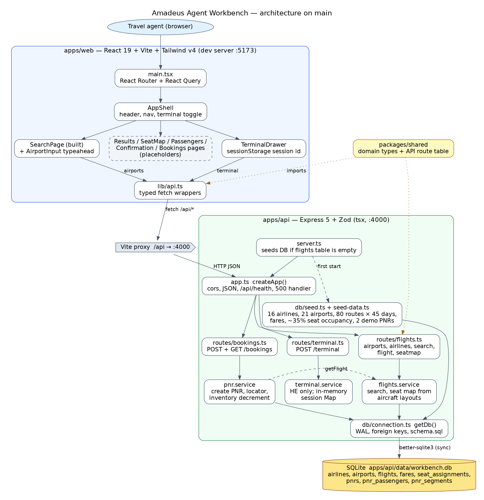

# Amadeus Agent Workbench

An Amadeus-style travel agent workbench: flight availability, fare families, seat map and PNR creation — with a
cryptic-command terminal panel alongside the modern GUI. Built as a training demo for Devin Desktop.

> Training demo only. Not affiliated with Amadeus IT Group. All data is synthetic.

## Quick start

Requires Node 22 (see `.nvmrc`; `nvm use` picks it up).

```bash
npm install
npm run dev        # API on http://localhost:4000, web on http://localhost:5173 (proxies /api to the API)
```

The SQLite database (`apps/api/data/workbench.db`) is created and seeded automatically on first start.
Re-seed any time with `npm run seed`.

## Layout

| Path              | What                                                                     |
| ----------------- | ------------------------------------------------------------------------ |
| `apps/web`        | React 19 + Vite + Tailwind v4 frontend                                   |
| `apps/api`        | Express 5 + TypeScript + Zod API over SQLite (`better-sqlite3`)          |
| `packages/shared` | Domain types and API route constants shared by both                      |
| `docs/`           | [Architecture notes](docs/ARCHITECTURE.md) and the diagram source/render |

See [`docs/ARCHITECTURE.md`](docs/ARCHITECTURE.md) for how the pieces fit together.



## Scripts

| Command             | Purpose                                  |
| ------------------- | ---------------------------------------- |
| `npm run dev`       | Start API + web with hot reload          |
| `npm run seed`      | Rebuild the SQLite database from scratch |
| `npm run build`     | Type-check all workspaces, build web     |
| `npm test`          | Vitest across all workspaces             |
| `npm run typecheck` | `tsc --noEmit` across all workspaces     |
| `npm run lint`      | ESLint                                   |
| `npm run format`    | Prettier                                 |

## Demo data

- 16 airlines with bundled logos, 21 airports across Europe, North America, the Gulf and Asia.
- 45 days of schedules, fare families `LIGHT` / `STANDARD` / `FLEX` in Economy and Business.
- Demo PNRs `X7K2PQ` and `M3JR8T`.
- Cryptic terminal: only `HE` (help) is implemented today. The help text lists `AN20SEPLHRJFK`, `SS1Y1`, `RT` and
  `RTX7K2PQ`, but those return `INVALID ENTRY`.

## Current state

Only the search page is built. The results, seat map, passenger, confirmation and bookings pages are placeholders, even
though the API endpoints behind them exist. Training exercises are not in the repo yet.
