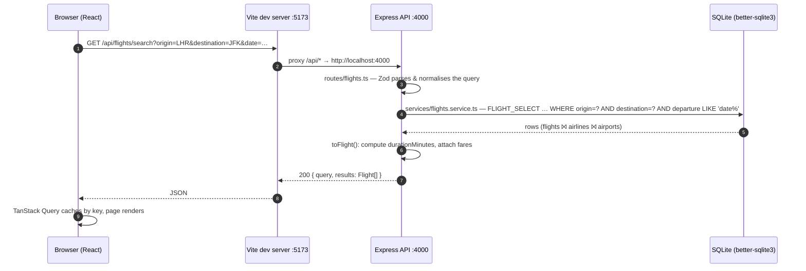
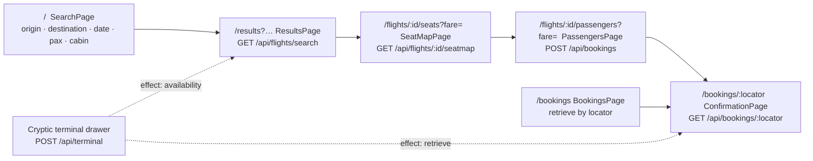
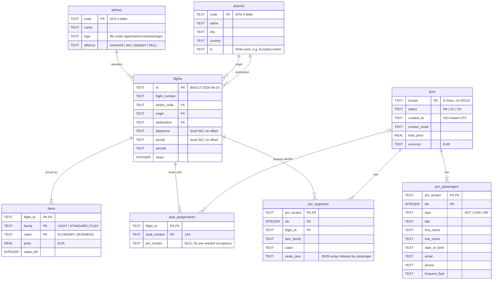

# Architecture

How the Amadeus Agent Workbench is put together: the monorepo layout, how a request travels from the browser to SQLite
and back, the data model, the time-handling convention, seeding, the cryptic terminal's session model and the testing
strategy. Read this before the [training exercises](EXERCISES.md); every exercise points back here.

## Monorepo layout

npm workspaces, one `package-lock.json` at the root, TypeScript everywhere, no build step in development (`tsx` runs the
API, Vite serves the web app straight from source).

```
amadeus-agent-workbench/
├── package.json                 root scripts: dev / seed / test / typecheck / lint / format / e2e
├── tsconfig.base.json           strict TS shared by every workspace (ES2022, Bundler resolution)
├── eslint.config.js             flat config: @eslint/js + typescript-eslint + react-hooks/react-refresh for apps/web
├── .prettierrc                  singleQuote, printWidth 120, trailingComma all
├── .github/workflows/ci.yml     typecheck → lint → unit tests → Playwright smoke
├── packages/shared/src/index.ts ALL domain types + the `API` route table (no runtime deps)
├── apps/api/                    Express 5 + Zod + better-sqlite3 (port 4000)
│   ├── src/server.ts            entry: opens the DB, auto-seeds if empty, listens
│   ├── src/app.ts               `createApp()` — used by server.ts and by Supertest
│   ├── src/routes/*.ts          HTTP layer: Zod validation, status codes, error envelopes
│   ├── src/services/*.service.ts business logic + SQL (flights, pnr, terminal)
│   ├── src/db/                  schema.sql, connection.ts, seed.ts, seed-data.ts
│   ├── src/lib/time.ts          local-time ↔ instant helpers
│   └── data/workbench.db        SQLite file (gitignored, created on first run)
└── apps/web/                    React 19 + Vite 6 + Tailwind v4 + React Router 7 + TanStack Query (port 5173)
    ├── src/main.tsx             router + QueryClient provider
    ├── src/components/          AppShell, TerminalDrawer, AirportInput, ui.tsx primitives
    ├── src/pages/               one file per funnel step
    ├── src/lib/                 api.ts (typed fetchers), format.ts, logos.ts, cn.ts
    ├── src/styles.css           Tailwind v4 `@theme` tokens (amadeus-*, sunrise-*, terminal-*)
    ├── e2e/smoke.spec.ts        Playwright smoke suite
    └── playwright.config.ts     boots `npm run dev` and waits for /api/health through the proxy
```

`@workbench/shared` is consumed **as source** (`"main": "./src/index.ts"`); nothing is compiled. Both apps' tsconfigs
include `../../packages/shared/src` so a type change is checked in three places at once.

## Request flow

The browser only ever talks to the Vite dev server. Vite proxies `/api/*` to Express (see `apps/web/vite.config.ts`),
so there is no CORS in development and the web app can use relative URLs from the shared `API` table.



Layering inside the API is deliberate and thin:

| Layer              | Responsibility                                                                                      |
| ------------------ | --------------------------------------------------------------------------------------------------- |
| `routes/*.ts`      | Parse and validate input with Zod; translate `BookingError.status` etc. into HTTP; never touch SQL  |
| `services/*.ts`    | All SQL and domain rules; return shared types (`Flight`, `Pnr`, …); throw typed errors              |
| `db/connection.ts` | One process-wide `better-sqlite3` connection (`getDb()`), plus `openMemoryDb()`/`setDb()` for tests |
| `lib/time.ts`      | Pure helpers; no DB access                                                                          |

Errors always use the `ApiError` envelope from `packages/shared`: `{ error: string, details?: unknown }` with a 4xx
status. `app.ts` has a final handler that turns anything unexpected into a bare `500 { error: 'Internal server error' }`.

### Endpoints

| Method | Path                       | Handler                          | Returns                               |
| ------ | -------------------------- | -------------------------------- | ------------------------------------- |
| GET    | `/api/health`              | `app.ts`                         | `{ ok: true, service }`               |
| GET    | `/api/airports?q=`         | `flights.service#searchAirports` | `Airport[]` (max 10)                  |
| GET    | `/api/airlines`            | `flights.service#listAirlines`   | `Airline[]`                           |
| GET    | `/api/flights/search`      | `flights.service#searchFlights`  | `{ query, results: Flight[] }`        |
| GET    | `/api/flights/:id`         | `flights.service#getFlight`      | `Flight` or 404                       |
| GET    | `/api/flights/:id/seatmap` | `flights.service#getSeatMap`     | `SeatMap` or 404                      |
| POST   | `/api/bookings`            | `pnr.service#createBooking`      | `201 Pnr`, or 400/404/409 `{ error }` |
| GET    | `/api/bookings/:locator`   | `pnr.service#getPnr`             | `Pnr` or 404                          |
| POST   | `/api/terminal`            | `terminal.service#runCommand`    | `TerminalCommandResponse`             |

## The booking funnel

Routes are declared in `apps/web/src/main.tsx`; every page renders inside `AppShell` (header, nav, footer, terminal
drawer). State between steps travels in the URL (`/flights/:id/seats?fare=STANDARD`) so any step is refresh-safe.



The terminal is mounted once in `AppShell` and stays open across navigation. Its responses can carry an `effect`
(`availability` | `sell` | `retrieve` | `none`) so the GUI can mirror a cryptic command — that wiring belongs to the
terminal feature work; the scaffold only renders the text.

## Data model

Defined in `apps/api/src/db/schema.sql` and applied with `CREATE TABLE IF NOT EXISTS` every time a connection opens, so
a fresh clone needs no migration step. Foreign keys are enforced (`PRAGMA foreign_keys = ON`).



Things worth knowing when you extend it:

- **Seat map is derived, not stored.** `getSeatMap()` builds rows from the aircraft layout (`seed-data.ts#layoutFor`:
  regional 2-2, narrowbody 3-3, widebody 3-3-3) and marks a seat `taken` if it appears in `seat_assignments`. Seat
  surcharges are computed in code, not in the DB.
- **`seats_json` on `pnr_segments`** is a JSON array aligned to passenger index (`seats[i]` belongs to `pnr_passengers.idx = i`);
  `null` means unassigned.
- **Prices are `REAL` EUR decimals** (`129.99`). Any new pricing arithmetic should work in integer cents to avoid drift.
- **`pnr_locator` on `seat_assignments`** is nullable so the seed can pre-fill ~35 % occupancy without inventing PNRs.
- Deleting a `flights` row cascades to `fares` and `seat_assignments` but is **blocked** by `pnr_segments` (no cascade) — a
  booked flight cannot be removed.

## Time handling

This is the convention that trips people up, and it is the subject of Exercise 2.

- `flights.departure` / `flights.arrival` are **local wall-clock** ISO-8601 strings **without an offset**:
  `"2026-09-16T08:25:00"`. That is how airlines publish schedules and how agents read them.
- The zone lives on the airport: `airports.tz` is an IANA name (`Europe/London`, `America/New_York`). The API returns it
  on `Flight.origin.tz` / `Flight.destination.tz`.
- Converting to an absolute instant **always** goes through `apps/api/src/lib/time.ts`:
  - `localToInstant(localIso, tz): Date` — wall-clock in `tz` → instant (DST-safe, two-pass offset check).
  - `instantToLocal(instant, tz): string` — instant → wall-clock in `tz`.
  - `tzOffsetMinutes(instant, tz)` — uses `Intl.DateTimeFormat`, so no timezone library is needed.
- The seed builds arrivals correctly: departure local → instant, add block minutes, → arrival local **in the destination
  zone**. So a 17:00 NRT departure with 600 block minutes is stored as a 10:00 LAX arrival the same calendar day.
- `durationMinutes(departure, arrival)` in the scaffold parses both strings with `new Date()` and subtracts. Without the
  zones it is only right when both airports share an offset — hence the skipped test and the negative durations in the
  UI for westbound flights.
- The web app never converts. `format.ts#formatTime` slices `HH:MM` straight out of the string, `formatDate` parses the
  date part only, and `dayOffset` compares the two calendar dates for the "+1" badge.
- `pnrs.created_at` is the exception: a true UTC instant (`new Date().toISOString()`), because it is a timestamp of an
  event, not a schedule.

## Seeding

`apps/api/src/db/seed.ts` rebuilds the database inside one transaction: `reset()` (delete in FK order) → reference data
(`AIRLINES`, `AIRPORTS`) → flights → demo PNRs.

- **Rolling window.** `DAYS = 45` flights per route, starting from today (UTC). Re-seed at the start of a session or the
  window shrinks.
- **Deterministic per flight.** Each flight id is hashed (FNV-1a) into a `mulberry32` PRNG, so prices, `seats_left` and
  pre-sold seats are stable between runs for the same date, while still varying flight-to-flight.
- **Fares.** From `RouteDef.base` (economy STANDARD): LIGHT = 0.82×, FLEX = 1.45×, Business STANDARD = 3.6×, Business
  FLEX = 4.4×, with a demand curve that raises prices as departure approaches.
- **Occupancy.** ~35 % of seats are inserted into `seat_assignments` with `pnr_locator = NULL`.
- **Demo PNRs.** `X7K2PQ` — Amelie Durand, `BA0117-<today+7>`, STANDARD, seat 14A. `M3JR8T` — James & Chioma Okafor,
  `SQ0322-<today+1>`, FLEX, seats 22D/22E. Their seats are written into `seat_assignments` with the locator.
- **Triggers.** `server.ts` seeds automatically when `flights` is empty; `npm run seed` forces a rebuild; tests call
  `seed(db)` against an in-memory DB.

Set `WORKBENCH_DB=/some/path.db` to point the API at a different file.

## Terminal session model

The cryptic drawer (`apps/web/src/components/TerminalDrawer.tsx`) is a thin client: it POSTs `{ command, sessionId }`
to `/api/terminal` and appends the returned `lines` to a scrolling monospace buffer. Output is uppercase English by
convention and must stay that way (Exercise 5 explicitly excludes it from i18n).

- `sessionId` is generated once per browser tab and kept in `sessionStorage` (`workbench.terminal.session`), so two tabs
  are two agents.
- `apps/api/src/services/terminal.service.ts` keeps an in-memory `Map<sessionId, TerminalSession>` with
  `lastAvailability: string[]` (flight ids in display order, so `SS1Y2` can mean "line 2 of what I just saw") and
  `currentPnr`. It is process memory: a restart forgets every session, which is fine for a demo.
- `runCommand()` upper-cases and trims the input, then dispatches. The scaffold implements `HE`; `AN`, `SS`, `NM`,
  `ET`, `RT`, `IG` arrive with the terminal feature work. Unknown input answers `INVALID ENTRY — TYPE HE FOR HELP`.
- Responses may include an `effect` so the GUI can react (`availability` → navigate to results, `retrieve` → open the
  PNR). See `TerminalCommandResponse` in `packages/shared`.

## Testing strategy

Three layers, cheapest first; all run from the root and all run in CI (`.github/workflows/ci.yml`).

| Layer           | Tool                     | Where                                          | What it proves                                                 |
| --------------- | ------------------------ | ---------------------------------------------- | -------------------------------------------------------------- |
| Unit            | Vitest                   | `apps/api/src/lib/time.test.ts`                | Pure helpers; the skipped westbound case is Exercise 2         |
| API integration | Vitest + Supertest       | `apps/api/src/routes/*.test.ts`                | Real Express app over a real (in-memory) SQLite with real seed |
| Component       | Vitest + Testing Library | `apps/web/src/**/*.test.tsx` (jsdom; none yet) | Page/component behaviour without a browser                     |
| Browser smoke   | Playwright (Chromium)    | `apps/web/e2e/smoke.spec.ts`                   | The whole stack boots and the funnel can be entered            |

The API pattern to copy is `apps/api/src/routes/flights.test.ts`:

```ts
beforeAll(() => {
  const db = openMemoryDb(); // fresh schema in RAM
  setDb(db); // services now read/write this connection
  seed(db); // same data the app runs on
});
```

No mocks: services hit SQL, so tests catch real query mistakes. Each test file gets its own in-memory DB, so files can
run in parallel.

Playwright (`apps/web/playwright.config.ts`) starts `npm run dev` from the repo root and polls
`http://localhost:5173/api/health` — through the Vite proxy — until it returns 200, which guarantees both servers are
up and the DB is seeded. Locally it reuses an already-running dev server; in CI (`CI=true`) it always starts a fresh
one and retries flaky tests twice.

Run everything the way CI does:

```bash
npm run typecheck && npm run lint && npm test && npm run e2e
```
