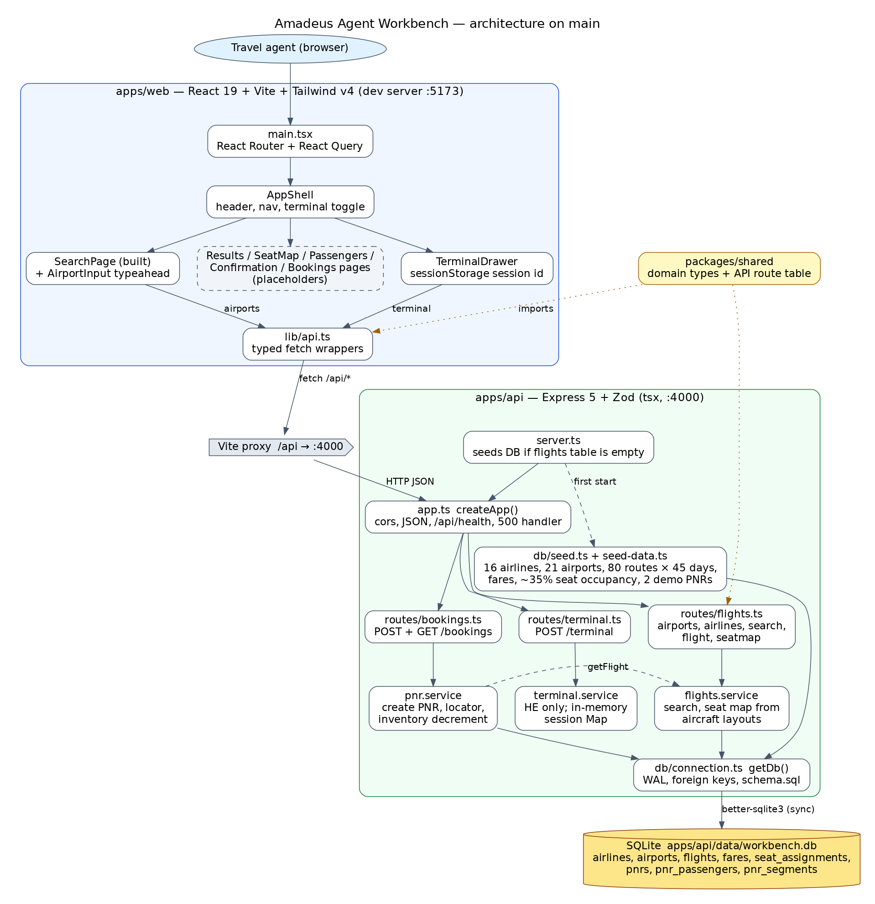

# Architecture

This describes what the code on `main` does today. The booking funnel past the search form and most terminal commands
are still placeholders; they are called out below.

The diagram source is [`diagrams/architecture.dot`](diagrams/architecture.dot) (Graphviz). After editing it, run
`docs/diagrams/render.sh` to regenerate [`architecture.png`](diagrams/architecture.png) and
[`architecture.svg`](diagrams/architecture.svg).

## Overview

An npm-workspaces monorepo with three packages:

| Workspace         | Runtime                                                      | Role                                                     |
| ----------------- | ------------------------------------------------------------ | -------------------------------------------------------- |
| `apps/web`        | React 19, React Router 7, React Query 5, Vite 6, Tailwind v4 | Agent-facing GUI and cryptic-terminal drawer             |
| `apps/api`        | Express 5 run by `tsx`, Zod, `better-sqlite3`                | REST API over a local SQLite file                        |
| `packages/shared` | TypeScript source only (no build output)                     | Domain types and the `API` route table used by both apps |

In development `npm run dev` starts both apps with `concurrently`: the API on `:4000` and the Vite dev server on `:5173`.
Vite proxies every `/api` request to `:4000`, so the browser only talks to one origin. There is no production server
for the web app: `npm run build` type-checks every workspace and writes the static bundle to `apps/web/dist`.

## Web app (`apps/web`)

- `src/main.tsx` creates the React Query client (30 s stale time, one retry) and the router. All routes render inside
  `AppShell`.
- `AppShell` draws the header and navigation (Search, Bookings) and mounts `TerminalDrawer`, so the terminal is
  available on every page.
- `SearchPage` (`/`) is the only built page. Its `AirportInput` typeahead calls `GET /api/airports`, and submitting the
  form navigates to `/results?origin=..&destination=..&date=..&passengers=..[&cabin=..]`.
- `ResultsPage`, `SeatMapPage`, `PassengersPage`, `ConfirmationPage` and `BookingsPage` are placeholders that render
  "This page has not been built yet." The API endpoints they would use already exist.
- `TerminalDrawer` keeps a random session id in `sessionStorage` (`workbench.terminal.session`), posts each command to
  `POST /api/terminal`, and appends the returned lines. It ignores the response's `effect` field.
- `src/lib/api.ts` wraps `fetch` for every endpoint, using URLs from the shared `API` table, and turns non-2xx
  responses into `ApiRequestError`. `src/lib/logos.ts` maps airline logo filenames from the API to the SVGs bundled
  under `src/assets/logos`.

## API (`apps/api`)

- `src/server.ts` opens the database, seeds it when the `flights` table is empty, and listens on `PORT` (default
  `4000`).
- `src/app.ts` exports `createApp()`, which adds CORS, JSON body parsing, `GET /api/health`, the three routers and a
  final error handler that returns `{ "error": "Internal server error" }` with status 500. Tests mount this factory
  with supertest instead of binding a port.
- Routes validate input with Zod and return `{ error, details }` with status 400 when it fails.

| Method | Path                       | Handler                                                                                             |
| ------ | -------------------------- | --------------------------------------------------------------------------------------------------- |
| GET    | `/api/health`              | `app.ts`                                                                                            |
| GET    | `/api/airports?q=`         | `flights.service.searchAirports`: match on code, city or name, max 10                               |
| GET    | `/api/airlines`            | `flights.service.listAirlines`                                                                      |
| GET    | `/api/flights/search`      | `flights.service.searchFlights`: route + local date, hides flights without enough seats in any fare |
| GET    | `/api/flights/:id`         | `flights.service.getFlight`                                                                         |
| GET    | `/api/flights/:id/seatmap` | `flights.service.getSeatMap`: aircraft layout plus sold seats                                       |
| POST   | `/api/bookings`            | `pnr.service.createBooking`: creates a one-segment PNR                                              |
| GET    | `/api/bookings/:locator`   | `pnr.service.getPnr`                                                                                |
| POST   | `/api/terminal`            | `terminal.service.runCommand`                                                                       |

### Services

- **`flights.service`** joins `flights` with `airlines` and both `airports`, attaches fares (optionally filtered by
  cabin) and computes block time. Seat maps are generated on request from one of three layouts in
  `db/seed-data.ts` (regional 2-2, narrowbody 3-3, widebody 3-3-3, picked from the aircraft name). Seats listed in
  `seat_assignments` are marked `taken`.
- **`pnr.service`** looks up the flight and the requested fare family (Economy first, then any cabin), checks
  `seats_left` and that there is one seat entry per passenger, then in one transaction inserts the PNR, passengers and
  segment, records chosen seats in `seat_assignments` and decrements `seats_left`. Locators are six characters from an
  alphabet without `0/O/1/I`. New PNRs are always status `HK`, and the price is fare price × passengers.
- **`terminal.service`** keeps per-session state (last availability, current PNR) in an in-memory `Map`, which is lost
  when the API restarts. Only `HE` (help) is implemented; every other entry, including `AN`, `SS` and `RT` listed in the
  help text, returns `INVALID ENTRY — TYPE HE FOR HELP`.

### Data

- `db/connection.ts` opens one process-wide `better-sqlite3` connection to `apps/api/data/workbench.db` (override with
  `WORKBENCH_DB`), turns on WAL and foreign keys, and applies `db/schema.sql` (all `CREATE ... IF NOT EXISTS`) on every
  start. `openMemoryDb()` and `setDb()` let tests swap in an in-memory database.
- Tables: `airlines`, `airports`, `flights`, `fares`, `seat_assignments`, `pnrs`, `pnr_passengers`, `pnr_segments`.
  Flight departure and arrival are stored as local wall-clock ISO strings without an offset; `lib/time.ts` converts
  them through the airport's IANA timezone with `Intl` when an instant is needed.
- `db/seed.ts` (`npm run seed`) wipes every table and rebuilds it in one transaction: 16 airlines, 21 airports, and one
  flight per route per day for 80 routes over the next 45 days (3,600 flights). Each flight gets five fares (Economy
  LIGHT / STANDARD / FLEX, Business STANDARD / FLEX) from a deterministic per-flight PRNG, about 35% of seats pre-sold,
  and there are two demo PNRs, `X7K2PQ` (BA0117 in a week) and `M3JR8T` (SQ0322 tomorrow). Because the schedule
  starts on the seed date, re-seed after 45 days to keep future flights.

## Tests and tooling

- API tests (Vitest + supertest) seed an in-memory database: `routes/flights.test.ts` covers search, validation and
  the seat map; `lib/time.test.ts` covers the time helpers (one westbound-transpacific case is skipped).
- `apps/web` has a Vitest + jsdom setup but no test files yet.
- ESLint 9 flat config (`eslint.config.js`) and Prettier (`.prettierrc`) cover the whole repo. There is no CI
  workflow and no pre-commit hook.
